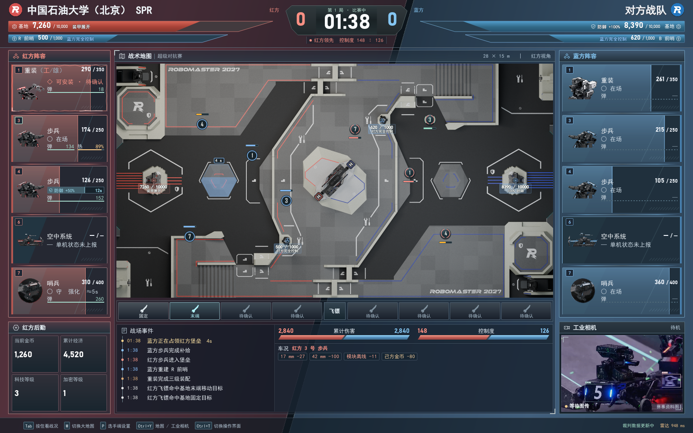
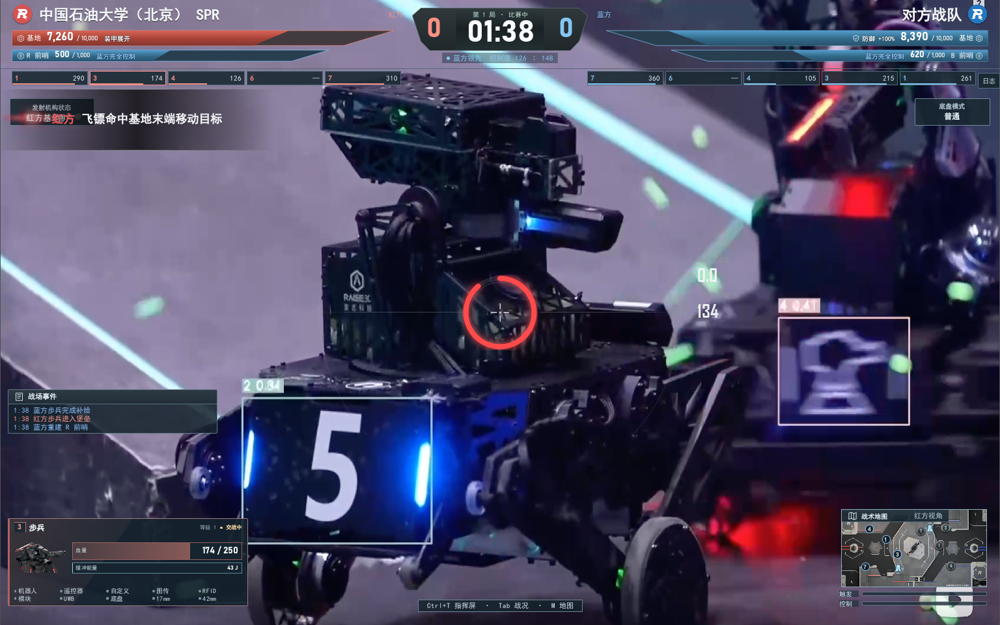
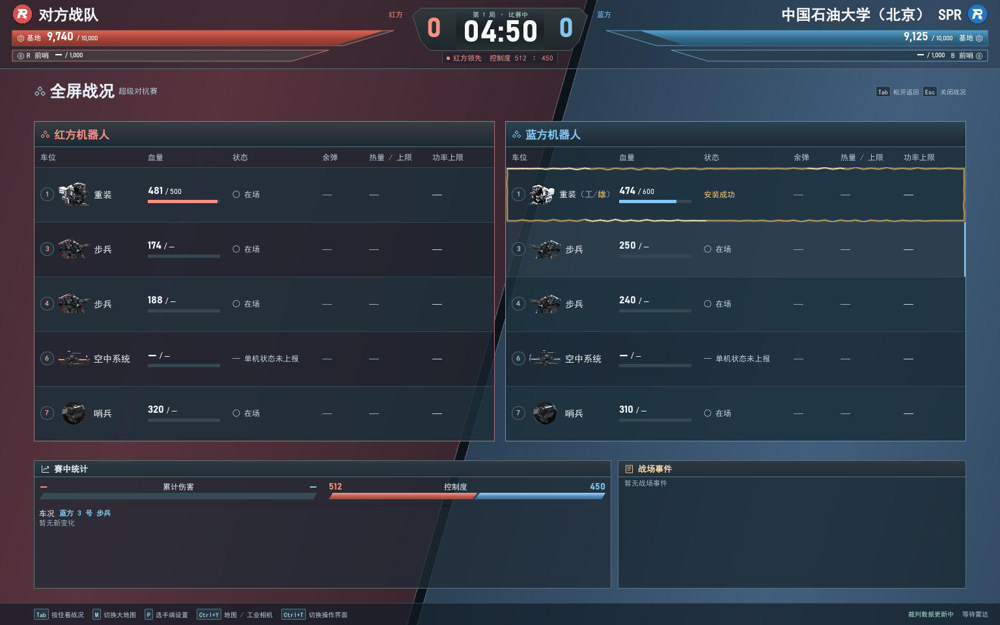

# SPR_Client_27

[简体中文](README.md) · [English](README.en.md)

A **RoboMaster 2027 custom client** maintained by the China University of Petroleum (Beijing) SPR team. Pilots can monitor their robot and match state over the main video feed. The command screen brings together both rosters, the arena map, battlefield events and the industrial camera. The project builds on Fudan EGA's RM26 Custom Client. [Upstream project](https://github.com/ClearWei/RM26_Client)

[Match profiles](#match-profiles) · [Client views](#client-views) · [SPR changes](#spr-2027-changes) · [Quick start](#quick-start) · [Integration and verification](#integration-and-verification)

> The screenshots show the running client with local test data. Windows and Ubuntu builds and automated tests have passed. Integration with the official 2027 engine, venue network and video hardware is pending.

## Match profiles

Press `P`, choose the competition profile, then select the assigned red or blue seat. These are the seats offered by the login menu. The roster can also display other robots reported by the match data. Blue wire IDs are the corresponding red IDs plus 100.

| Profile | Config value | Arena | Login seats |
| --- | --- | --- | --- |
| RMUC | `rmuc2027` | 28 × 15 m | Heavy 1, infantry 3 and 4, aerial system 6 |
| RMUL 3v3 | `rmul3v3` | 12 × 8 m | Heavy 1 and infantry 3 |
| RMUL 1v1 | `rmul1v1` | 5 × 5 m | Infantry 3 |

[3v3 command screen](docs/images/readme/command-rmul-3v3.png) · [1v1 command screen](docs/images/readme/command-rmul-1v1.png)

## Client views

| View | What it shows | How to open it |
| --- | --- | --- |
| Pilot settings | Competition profile and seat selection. Team-specific indicators follow the selected seat. | `P` |
| Command screen | Match clock, score, both rosters, arena map, objective health where applicable, match events and a camera preview. | `Ctrl+T` switches between the command screen and pilot video. |
| Map or industrial-camera priority | The central area switches between the map and camera. A secondary map remains available in camera-priority mode. | `Ctrl+Y` on the command screen |
| Pilot video | A full-screen video feed with the shared match header, robot HUD, minimap and interaction prompts. | `Ctrl+T` |
| Full-screen match status | Both rosters and match statistics. RMUC shows base and outpost health, while RMUL includes the arena map. | Hold `Tab`. Release it or press `Esc` to close. |
| Expanded map | Arena geometry, reported locations and objective state for the selected profile and team perspective. | `M` |
| Role panels and match results | Ammo supply, exchange or role-specific actions where available. Results can be dismissed via the close button or `Esc`. | `O`, `I` or `H` from pilot view, depending on the action |

The video background below is a test frame. The HUD is drawn by the client. [Keyboard shortcuts and role controls](docs/getting-started/keyboard-shortcuts.md)

## SPR 2027 changes

- The client uses distinct RMUC, RMUL 3v3 and RMUL 1v1 seat lists, layouts and maps. The map orientation follows the logged-in team.
- The redesigned command screen combines rosters, current robot status, battlefield events and a choice of map or industrial-camera priority. The pilot HUD and full-screen match status share the match information with the command screen.
- Selected 2027 messages feed objectives, control, robot state, positions and timing into the UI. Unknown or unavailable values show a placeholder.
- The logged-in team's heavy card displays an unlock indicator, a transition animation after installation confirmation, and a gold completed state. The other team's heavy card uses the regular presentation. The public `Event 16` does not define a team or robot ID, so the client uses attributable data for team-specific effects.
- Windows and Linux launch tooling, Windows dependency detection and network restoration support the existing local runtime kit. Test coverage includes profile layouts, seat changes, keyboard shortcuts and heavy-robot effects. [Changelog](CHANGELOG.md)

## Quick start

Follow the [step-by-step user guide (Chinese)](docs/getting-started/user-guide.md) to download the repository, install dependencies, build on Windows or Ubuntu, preview offline, run a simulated match, and connect to official match services.

On Windows, open Command Prompt by typing `cmd` in File Explorer’s address bar at the source root. Follow the [Windows steps](docs/getting-started/user-guide.md#windows-x64从-cmd-开始) for one-time setup. After the first successful build, use the same batch file to launch the client.

GitHub distributes source code, assets, the simulator, and build tools. The prebuilt executable and double-click launchers are distributed separately as part of the team's runtime kit. See the [runtime kit notes](scripts/portable/README.md) if you already have that package.

## Integration and verification

Copy `config.example.json` to a local `config.json`. The template uses loopback for the match connection. Use venue-specific settings when connecting to the official system.

| Feed | Transport | Local configuration |
| --- | --- | --- |
| Match state | MQTT + Protobuf | `competition.mqtt_broker` and `competition.mqtt_port` for 2027, with port `3333` in the template. Match the player seat to the data source. |
| Main video | Fragmented HEVC/H.265 over UDP | Match `network.video_port` and `video.stream_url` to the forwarded feed. The template listens on `3334`. |
| Industrial camera | H.264 over MQTT `CustomByteBlock` | Uses the match MQTT connection and seat. |
| Optional team heavy-state sync | Separate wired team link | `competition.heavy_sync_source`, with default port `3346`. |

Use the **2026 compatibility profile** for the standalone simulator's baseline. Confirm the MQTT session and match data first, then test the UDP main video and MQTT camera individually. Selected 2027 UI behavior is covered by test fixtures. [Client configuration](docs/getting-started/configuration.md) · [Simulator](sim/README.md)

Windows verification includes an offline launch, 27 C++/Qt tests and portable-script checks. Ubuntu CI builds the app and runs 27 C++/Qt tests, simulator tests, the QML check and release audits. Formal 2027 field integration is pending.

## Repository and contributions

The Qt client lives in `src/`, arena and UI assets in `resources/`, the local simulator in `sim/`, portable launch tools in `scripts/portable/`, tests in `tests/`, and developer documentation in `docs/`.

Use Issues for reports and include the profile, seat, OS, reproduction steps, and expected and actual behavior. Propose changes through pull requests from a feature branch or fork for maintainers to merge into `main`. [Contributor guide](CONTRIBUTING.md) · [Documentation index](docs/README.md)

## References and licensing

The 2027 implementation references the [communication protocol](https://bbs.robomaster.com/wiki/20204847/1969151), the [RMUC rulebook](https://bbs.robomaster.com/wiki/20204847/1969149) and the [RMUL rulebook](https://bbs.robomaster.com/wiki/20204847/1969150). The arena images derive from the [official 2027 field drawings](https://bbs.robomaster.com/article/1970956).

Source code is available under the MIT License. Maps and other media follow their documented licenses. The project is independently maintained and has no affiliation with DJI or RoboMaster. [MIT License](LICENSE) · [Asset and screenshot register](ASSET_LICENSES.md)
