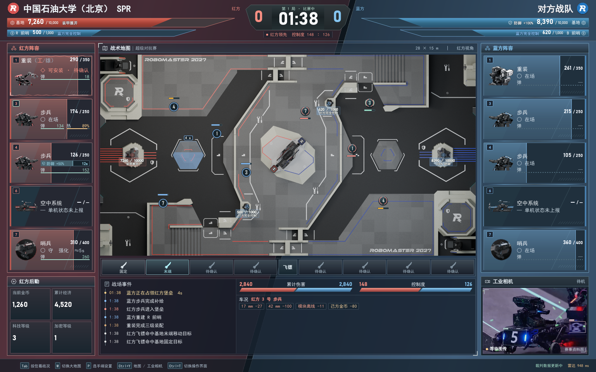
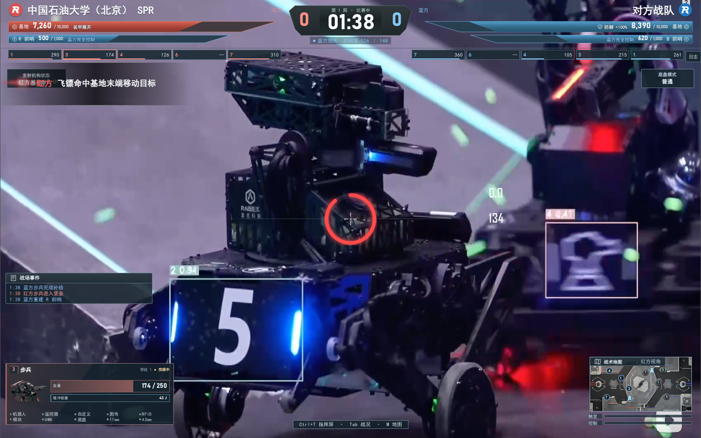
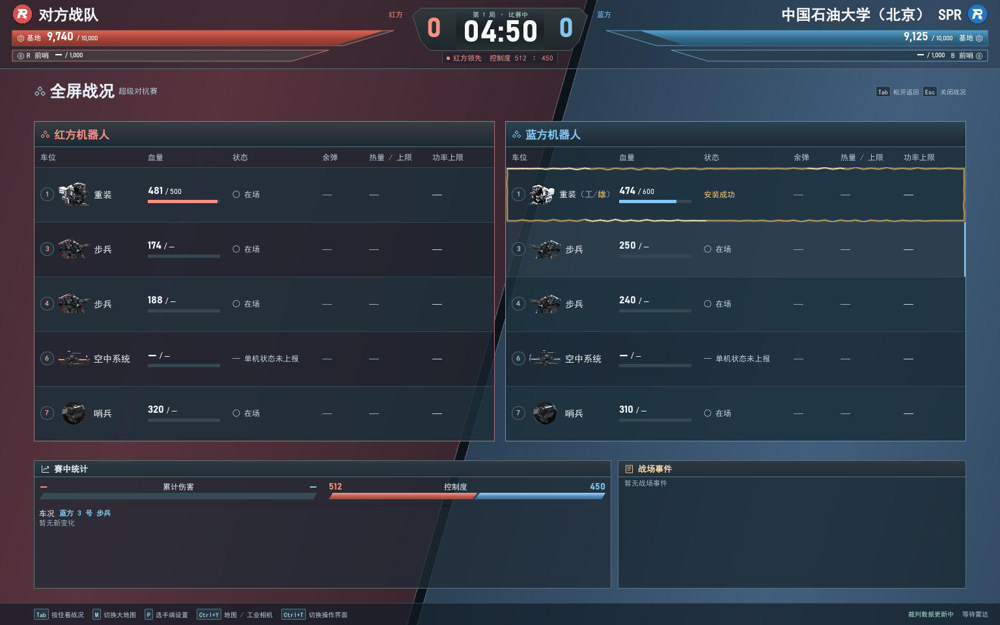

# SPR_Client_27

[简体中文](README.md) · [English](README.en.md)

中国石油大学（北京）SPR 战队的 **RoboMaster 2027 自定义客户端**。操作手可以在主图传界面查看比赛与车辆状态，指挥端可以查看双方阵容、战术地图、事件和工业相机。项目基于复旦大学星云 EGA 的 RM26 Custom Client 二次开发。 [上游项目](https://github.com/ClearWei/RM26_Client)

[赛项与车位](#赛项与车位) · [运行界面](#运行界面) · [SPR 2027 具体改动](#spr-2027-具体改动) · [快速开始](#快速开始) · [联调与验证](#联调与验证)

> **当前状态**
>
> Windows 与 Ubuntu 已完成构建和自动化回归。2027 正式赛事引擎、真实图传与现场网络待联调。下方界面截图来自客户端运行本地测试数据时的实际画面。

## 赛项与车位

按 `P` 打开设置，先选择赛项，再登录本场分配的红方或蓝方车位。下表列的是客户端设置页开放的登录车位，指挥屏还会展示裁判数据中可见的其他车位。蓝方 ID 对应红方 ID 加 100，例如红方 3 号为 `3`，蓝方 3 号为 `103`。

| 赛项 | 配置值 `competition.profile` | 场地 | 本客户端可选车位 | 战况重点 |
| --- | --- | --- | --- | --- |
| 超级对抗赛 | `rmuc2027` | 28 × 15 m | 重装 1、步兵 3 和 4、空中系统 6 | 基地、前哨、双方阵容、控制度与飞镖 |
| 高校联盟赛 3V3 | `rmul3v3` | 12 × 8 m | 重装 1、步兵 3 | 阵容、控制度、剩余血量与场地图 |
| 高校联盟赛 1V1 | `rmul1v1` | 5 × 5 m | 步兵 3 | 双方步兵血量、车辆状态与场地图 |

[联盟赛 3V3 指挥屏](docs/images/readme/command-rmul-3v3.png) · [联盟赛 1V1 指挥屏](docs/images/readme/command-rmul-1v1.png)

## 运行界面

### 选手端设置

`P` 打开或关闭设置。选车后，阵营视角、己方状态和重装特效随登录车位切换。也可以在设置里用数字键选车，再按 `Enter` 确认。例如红方 3 号按 `3`，蓝方 3 号按 `8`。 [完整选车键位](docs/getting-started/keyboard-shortcuts.md#在设置中选车)

### 战术指挥屏

- **顶部比赛栏**显示队名、比分、回合、阶段和倒计时。超抗显示双方基地和前哨血量。有明确领先依据时显示对应信息。
- **中央区域**默认显示赛项地图，可按 `Ctrl+Y` 切到工业相机主画面。切换后右侧仍可查看地图。
- **双方阵容**显示车位、血量和已收到的状态。余弹、热量、复活读条、增益等字段随车位和报文可用性显示。
- **赛中信息区**汇集飞镖、累计伤害、控制度或剩余血量、战场事件，以及当前车位的车况变化。
- 雷达和视频有各自的接收状态。看到「等待雷达」或「等待图传」时，可以据此检查对应数据源。未收到的数值用 `—` 等待上报提示表示。

### 全屏主图传

按 `Ctrl+T` 在指挥屏和操作手主图传之间切换。主图传界面共用顶部比赛栏，画面上叠加当前车位状态、小地图及操作提示。打开全屏战况时，客户端暂停键鼠转发，退出战况后恢复操作。

下图的背景是测试注入的演示画面，HUD、顶部比赛栏和小地图由实际客户端绘制。

### 全屏战况与大地图

- **按住 `Tab`**查看全屏战况，松开返回原界面，也可用 `Esc` 收起。超抗集中显示双方阵容和基地前哨信息。联盟赛战况同屏展示场地图及该赛项的数据。
- **按 `M`**打开或收起大地图。地图按当前赛项与红蓝视角绘制，展示已收到的定位、目标状态和赛项支持的场地信息。操作手可在大地图里用 `A`、`B`、`I` 选择相应标记类型。

### 补给、车位交互与结算

主图传界面用 `O`、`I` 打开相应弹丸补给窗口，登录车位后用 `H` 打开当前角色的兑换或专用面板。交互是否开放，以赛项、车位和裁判系统下发状态为准。进入结算后可以用页面关闭按钮或 `Esc` 收起结算。 [各角色操作与完整快捷键](docs/getting-started/keyboard-shortcuts.md)

| 快捷键 | 功能 |
| --- | --- |
| `P` | 选赛项和登录车位 |
| `Ctrl+T` | 切换主图传与指挥屏 |
| `Ctrl+Y` | 在指挥屏切换地图与工业相机的主视图 |
| 按住 `Tab` | 查看全屏战况 |
| `M` | 打开或收起大地图 |
| 按住 `~` | 查看伤害统计 |
| 按住 `F12` | 查看快捷键提示 |
| `Esc` | 收起战况或结算 |

## SPR 2027 具体改动

| 模块 | SPR 改动 |
| --- | --- |
| 赛项与地图 | 增加超抗、联盟赛 3V3 和 1V1 档位，按赛项选择场地图、车位和战况布局。以官方场图为来源制作俯视图和地形标注，支持红蓝视角切换。 |
| 指挥与操作视图 | 重做比赛栏、红蓝阵容、事件与车况区域，加入地图与工业相机互换布局，全屏主图传共用比赛栏。Tab 全屏战况与大地图均可从比赛界面快捷打开。 |
| 比赛数据适配 | 增加 2027 相关比分、目标状态、雷达位置、车况、计时、事件和重装状态的解析与界面映射。未知或未归属的数据保持待确认。 |
| 重装形态 | 已解锁时显示己方阵营色提示。收到可归属本队的安装确认后播放约一秒的变形动效，头像切换并进入金色状态。默认各终端独立接裁判数据，队内补充同步可单独配置。 |
| 联调与交付 | 整理 Windows 和 Linux 的运行脚本，补充 Windows 缺项依赖检查、离线启动与比赛网络还原入口，增加赛项、分辨率、红蓝换边、快捷键和重装状态回归。 |

重装安装事件 `Event 16` 在 2027 公开协议 V1.0.0 中未约定队别或车号。超抗三级装配与成功安装都可能出现 600 血量上限，界面仅展示能够归属本队的形态状态。 [状态来源与可选同步](docs/getting-started/configuration.md#重装状态跨终端同步) · [版本变更日志](CHANGELOG.md)

## 快速开始

**从 GitHub 下载后，请按[客户端使用指南](docs/getting-started/user-guide.md)操作。** 指南覆盖依赖安装、Windows 和 Ubuntu 编译、离线预览、模拟比赛及官方赛事接入。

GitHub 提供源码、资源、模拟器和构建工具。战队交付包里的预编译程序和双击启动入口随完整运行包提供。已经拿到完整运行包的队员可以查阅[运行包说明](scripts/portable/README.md)。

## 联调与验证

### 数据和图传如何接入

复制 `config.example.json` 为本机 `config.json`，按本次环境配置。示例默认连接本机回环。现场配置、账号、局域网地址和运行日志保存在本机。

| 数据 | 连接方式 | 要对齐的配置 |
| --- | --- | --- |
| 裁判比赛数据与支持的操作指令 | MQTT + Protobuf | 2027 档使用 `competition.mqtt_broker` 和 `competition.mqtt_port`，模板端口为 `3333`。客户端、选手端和数据源须对应同一车位。 |
| 主图传 | UDP 分片传输 HEVC/H.265 | `network.video_port` 与 `video.stream_url` 要和转发目标匹配，模板监听 `3334`。 |
| 工业相机 | MQTT `CustomByteBlock` 携带 H.264 数据 | 使用比赛数据对应的 Broker 和车位，和主图传是两条链路。 |
| 可选队内重装状态同步 | 单独的队内有线链路 | 按需填写 `competition.heavy_sync_source`，默认端口 `3346`。 |

只看界面时可以直接启动客户端。想验证本地消息与图传链路时，从客户端设置选 **2026 兼容档**，和仓库模拟器沿用的 2026 基线对齐。先验证 MQTT 比赛状态，再接主图传和工业相机。2027 的部分状态和界面由自动化测试报文覆盖。 [配置说明](docs/getting-started/configuration.md) · [模拟器启动及推流说明](sim/README.md)

### 当前验证范围

| 环境 | 已验证内容 |
| --- | --- |
| Windows / MinGW x64 / Qt 6.8.3 | 源码构建、离线启动、27 项 C++/Qt 回归、便携脚本及依赖检测 |
| Ubuntu / Qt 6.8.3 | GitHub Actions 原生构建、27 项 C++/Qt 回归、模拟器测试、QML 和公开发布预检 |
| 2027 正式赛场 | 正式赛事引擎、真实图传、赛场网络及角色交互待联调 |

[查看 GitHub Actions 验证记录](https://github.com/SPR-Algorithm/SPR_Client_27/actions/workflows/quality.yml)

## 目录与贡献

| 路径 | 内容 |
| --- | --- |
| `src/` | Qt 客户端、协议解析、车位状态与 QML 界面 |
| `resources/` | 场图、界面资源和音效 |
| `sim/` | 独立模拟器与 Web 控制台 |
| `scripts/portable/` | Windows、Linux 启动及打包工具 |
| `tests/`、`tools/release/` | 自动化回归与发布检查 |
| `docs/` | 安装配置、快捷键、协议依据和架构说明 |

通过 Issue 报告问题时，附上赛项、车位、系统、复现步骤、期望与实际表现。修改从自己的分支或 fork 发起 Pull Request，由维护者审核后合并到 `main`。 [贡献指南](CONTRIBUTING.md) · [文档索引](docs/README.md)

## 官方依据与许可

2027 自定义终端报文与图传参考通信协议 V1.0.0 第 2 章。重装事件和车位数据见 §2.2.7、§2.2.10 至 §2.2.12。超抗重装安装见规则 §5.7.1，联盟赛 3V3 重装血量见 §3.1.1。 [通信协议](https://bbs.robomaster.com/wiki/20204847/1969151) · [超抗规则](https://bbs.robomaster.com/wiki/20204847/1969149) · [高校联盟赛规则](https://bbs.robomaster.com/wiki/20204847/1969150) · [官方资料索引](docs/references/official-materials.md)

源代码使用 MIT 许可证，地图和其他素材按各自来源与许可使用。项目由参赛队伍维护，与 DJI 或 RoboMaster 无隶属关系。 [MIT License](LICENSE) · [官方场地图纸](https://bbs.robomaster.com/article/1970956) · [素材与截图许可](ASSET_LICENSES.md)
